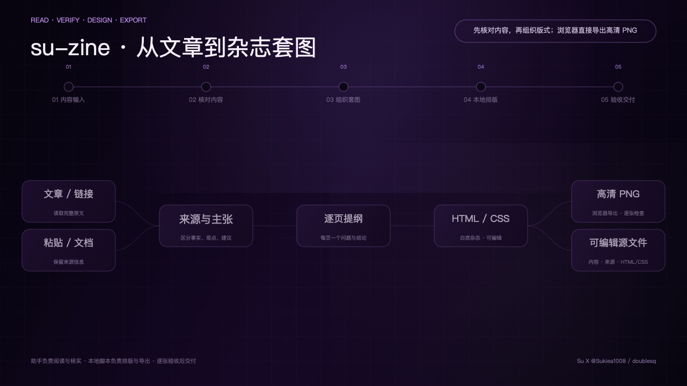
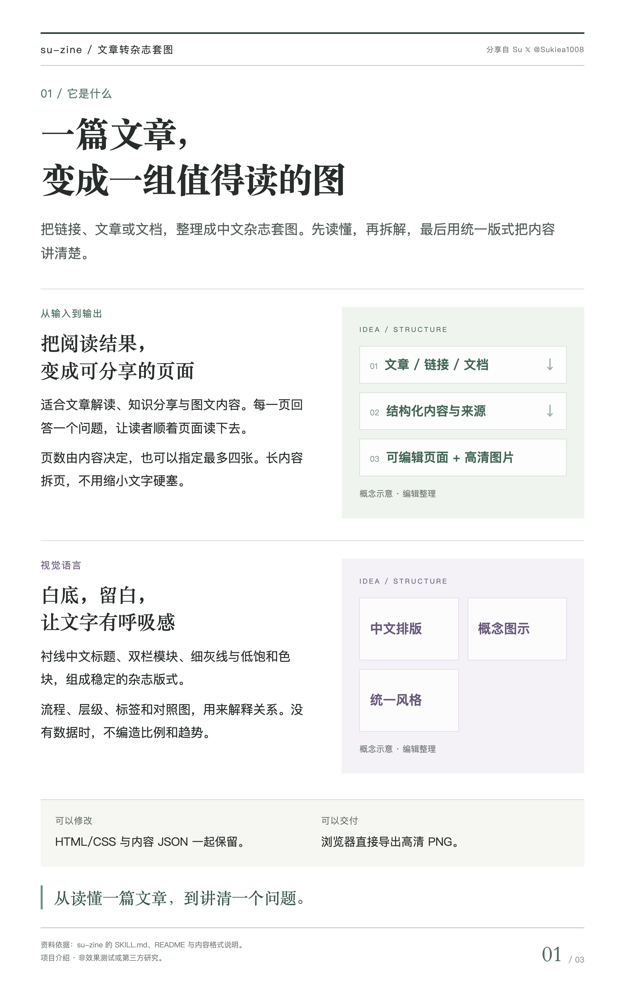
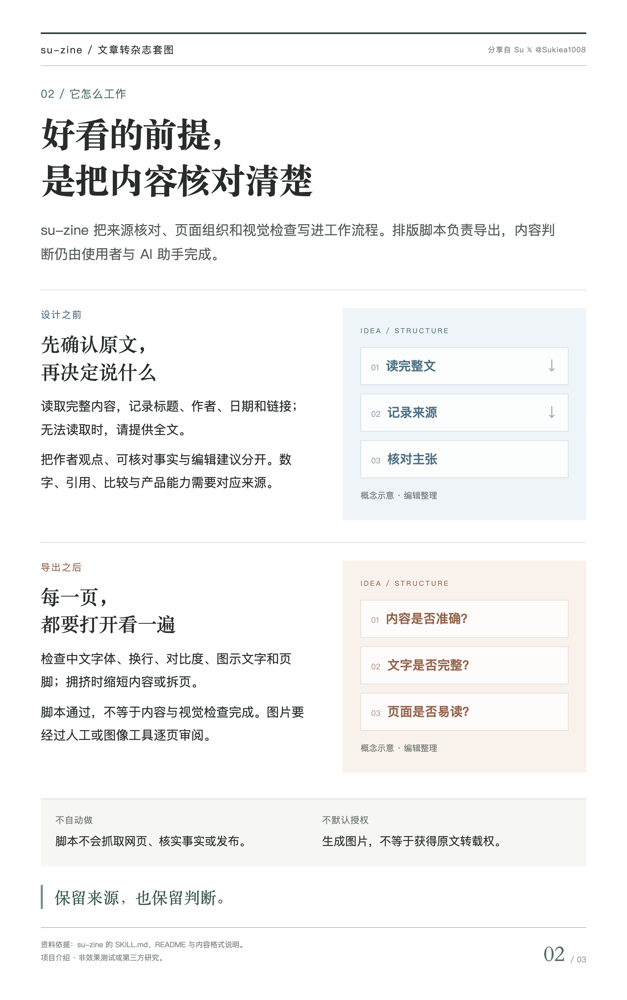
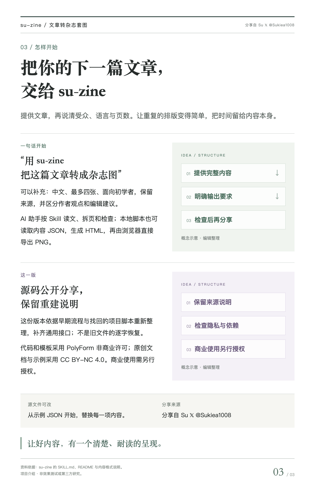

# su-zine

**把一篇文章，做成一组愿意读完的中文杂志图。**

分享自 Su 𝕏 @Sukiea1008

输入文章链接、粘贴文本或文档，先读全文、核对来源与主张，再把内容组织成白底、留白充足的套图。版式使用可编辑的 HTML/CSS，由浏览器直接导出高清 PNG。

<p align="center">
  
</p>

[看输出示例](#输出长什么样) · [一句话开始](#一句话开始) · [本地运行](#本地运行) · [许可说明](#许可与使用边界)

> **非商业源码开放项目。** 代码与模板采用 PolyForm Noncommercial 1.0.0，原创说明文档与示例内容采用 CC BY-NC 4.0。因限制商业用途，本项目不是 OSI 定义的开源。

## 适合做什么

- **文章拆解**：把长文的论点、依据与例子整理成连续阅读的图文。
- **知识分享**：将教程、报告或学习笔记做成易读的知识卡片。
- **项目介绍**：用统一的视觉风格说明一个工具、方法或工作流程。

页数跟着内容走，不固定四张。默认是白底杂志风，可以调整字体、留白和配色；先保证内容准确，再做视觉表达。

## 输出长什么样

下面是用 su-zine 制作的三张自我介绍图。点击可查看完整高清图。

<p align="center">
  <a href="output/intro/page-01.png"></a>
  <a href="output/intro/page-02.png"></a>
  <a href="output/intro/page-03.png"></a>
</p>

白底、中文衬线标题、细灰线、双栏模块与低饱和配色。支持流程、层级、标签、对照、补充说明和检查列表。图片高度随内容自然增长，不靠缩小正文硬塞。

## 一句话开始

把完整的 `su-zine` 文件夹交给支持 `SKILL.md` 的助手，放入它能识别的个人或项目 Skill 目录。保留 `scripts/`、`assets/` 和 `references/`，不要只复制说明文件。

也可以直接克隆仓库：

```bash
git clone https://github.com/doublesq97-ui/su-zine.git
```

然后告诉助手：

```text
用 su-zine 把这篇文章转成杂志图：中文，面向初学者，最多四张，保留来源，区分作者观点和编辑建议。先核对全文，再排版，最后逐张检查 PNG。
```

不支持自动发现 Skill 的客户端，也可以读取本目录的 `SKILL.md` 作为工作指引。是否能安装、读取链接和运行脚本，取决于客户端与权限。

**助手负责阅读、核实和组织内容；脚本只负责排版与导出。** 脚本不会自动抓取文章、查证事实，也不会替你发布。

## 工作流

1. **读完整原文**：记录作者、标题、日期、链接与访问时间；读取失败就补充全文。
2. **核对主张**：数字、引语与产品能力回到来源，区分事实、作者观点和编辑建议。
3. **组织套图**：每页回答一个问题，先写提纲和文案，再安排模块与图解。
4. **本地排版**：结构化内容生成可编辑的 HTML/CSS，浏览器直接导出 PNG。
5. **逐张验收**：检查文字、换行、边界、页脚和引用，连同源文件一起交付。

[静态流程图](docs/media/workflow-poster.png) · [MP4 演示](docs/media/workflow.mp4)

## 本地运行

需要 **Python 3.10+、Node.js 20+、Chrome/Chromium 和中文字体**。Python 无第三方依赖；浏览器导出使用 Playwright。

在项目根目录执行：

```bash
npm install
npx playwright install chromium

# 使用新目录，保留随包提供的原始示例
python3 scripts/build.py examples/intro/content.json --out output/my-first-zine
node scripts/render.cjs output/my-first-zine --scale 2

npm test
```

已有 Chrome/Chromium 时，可以设置 `CHROMIUM_PATH` 为其可执行文件路径，跳过浏览器下载。导出使用独立的临时上下文，不读取日常浏览器账户或个人配置。

默认宽度为 1200 CSS px，2 倍导出后的 PNG 宽度为 2400 px，高度随内容增长。输出包含 HTML、CSS、PNG 和 `render-report.json`，**没有 PDF 中间步骤**。

生成器要求新目录；导出器默认不覆盖已有 PNG。确需替换同目录导出结果时，给导出命令增加 `--overwrite`。

### 换内容、调版式

- 从 [`assets/example.json`](assets/example.json) 或 [`examples/intro/content.json`](examples/intro/content.json) 开始替换内容。
- JSON 格式、模块与命令见 [内容格式说明](references/content-schema.md)。
- 字体、边距和配色在 [`assets/style.css`](assets/style.css) 中调整。
- 内容字符串统一转义，不接受任意 HTML。

## 检查与边界

- **导出成功不等于内容正确。** 必须逐张打开 PNG，检查字体、事实、引用与排版。字体加载状态正常也不保证中文字形完整。
- **网页导出有范围限制。** 导出器关闭页面 JavaScript 与网络，只允许当前生成页面及同目录 `style.css`；这不是运行任意不可信 HTML 的安全沙箱。
- **过长就拆页。** 超过高度、像素限额或出现元素溢出时会报错，不要靠缩小正文绕过。
- **发布另行决定。** 生成图片不会自动上传到 GitHub、图床、社交媒体或网站。

更多信息：[隐私与数据](PRIVACY.md) · [依赖说明](DEPENDENCIES.md) · [验证记录](QA.md)

## 目录

| 路径 | 内容 |
|---|---|
| `SKILL.md` | 助手的完整工作流 |
| `scripts/` | JSON → HTML/CSS → PNG |
| `assets/`、`references/` | 版式、样例和内容格式 |
| `examples/intro/` | 介绍图文案与来源 |
| `output/intro/` | 实际浏览器导出的示例 |
| `docs/media/` | README 工作流动图、静态图与图结构源文件 |
| `tests/` | 构建与浏览器测试 |

## 许可与使用边界

- **代码与模板**：PolyForm Noncommercial 1.0.0。
- **原创说明文档与示例内容**：CC BY-NC 4.0。
- **同时包含模板设计与原创文案的成品**：按各部分的适用许可使用，不将整张图笼统改授为另一种许可。

逐文件范围见 [LICENSE-SCOPE.md](LICENSE-SCOPE.md)，完整条款见 [LICENSES/](LICENSES/)。署名与商业授权说明见 [NOTICE.md](NOTICE.md)，第三方依赖见 [THIRD-PARTY-NOTICES.md](THIRD-PARTY-NOTICES.md)。超出许可范围的商业使用需另行获得授权，不承诺自动许可。项目许可不替代浏览器、字体或输入原文的许可，也不改变使用者独立输入内容的权利归属。

本版依据先前工作流及找回的项目脚本重建适配，并非原始缺失资源的逐字恢复。旧 PDF 流程另行保留，本包不包含它，也不依赖 WeasyPrint 或 PyMuPDF。

## 看看我其他的开源项目

如果你也在探索 AI 协作、Skill 管理、视觉设计或内容生产，可以从 **[Su MIT Index](https://github.com/doublesq97-ui/su-mit-index)** 开始。这里整理了我其他采用 MIT 许可的项目，每个项目都有独立的说明、演示与安装方式。

这些项目的许可请以各自仓库为准；它们的 MIT 许可不适用于 su-zine。
